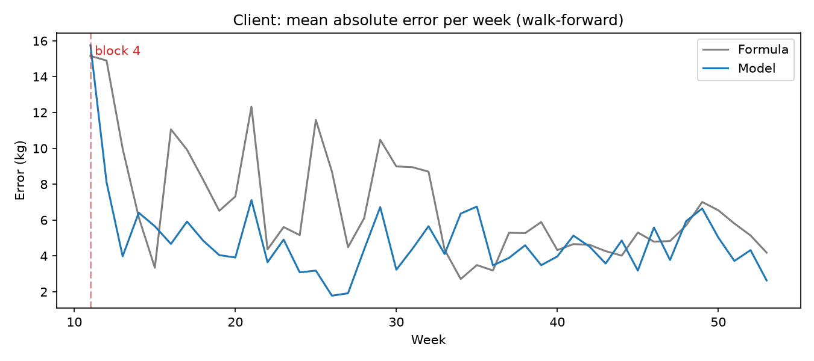
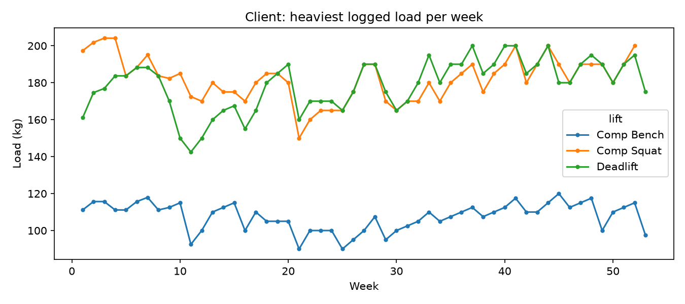

# Load prediction model

**Question:** given a lift, a rep count, and a target RPE, how heavy will the set be?
The use case is a coach choosing a load for a prescribed set.

> All results come from **one client's** training data (53 weeks, three comp lifts).
> They describe that client only and are not findings about lifters in general.

## Setup

- **Data:** a CSV export of one client's comp-lift sets (query in `export_sets.sql`), with a week
  index that runs across all blocks. Backdown sets are excluded. The export contains client data,
  so `data/` is gitignored.
- **Recent strength:** per lift and week, the best e1RM from sets at RPE 6+ over the previous
  3 weeks (earlier weeks only, so a week never sees itself).
- **Settings chosen up front, not tuned or varied:** RPE 6+ anchors, a 3-week window, a 10-week warm-up.

## Methods compared

| Method | What it does |
| --- | --- |
| Formula | The e1RM formula (Brzycki with an RPE-to-reps-in-reserve adjustment) run backwards from recent strength |
| Model | The formula plus a small per-lift linear correction on RPE |
| Last time | The load from the most recent earlier week with the same lift, reps, and RPE (exists only for repeat sets) |

## v1: single time split (superseded)

Trained on the first 70% of weeks and tested on the last 30% (191 sets). The model and the formula
could not be told apart, and "last time" looked best. That test covered about 15 weeks, and 187 of
its 191 sets had an exact earlier match, so it mostly measured how repetitive the program is.

## v2: walk-forward evaluation (current)

For each week after a 10-week warm-up, fit on all earlier weeks and predict that week (an expanding
window). 43 weeks, 540 sets: 501 repeats and 39 "novel" sets (a lift/reps/RPE combination never seen
in any earlier week).

| Subset | Method | Error (kg) | Error (%) |
| --- | --- | --- | --- |
| All 540 sets | Formula | 6.8 | 5.4% |
| | Model | 4.9 | 3.8% |
| 501 repeats | Last time | 5.3 | 4.1% |
| | Formula | 6.7 | 5.4% |
| | Model | 4.7 | 3.6% |
| 39 novel (exploratory) | Formula | 8.2 | 6.2% |
| | Model | 7.3 | 5.4% |

95% intervals, resampling whole weeks (positive = first method is worse):

- Formula minus model, all sets: +1.90 kg (+1.08 to +2.78). The model beats the formula.
- Model minus last time, repeats: -0.55 kg (-1.27 to +0.09). Too close to call.
- Formula minus model, novel sets: +0.97 kg (-2.12 to +3.99). 39 sets cannot settle it.

Excluding block 4 (13 sets, scored right after a break that the data does not record) gives a
formula-minus-model gap of +1.96 kg (+1.11 to +2.83).




## Limits

- One client with a highly repetitive program, so only 39 novel sets.
- Intervals resample weeks but ignore week-to-week correlation, so they may be slightly narrow.
- The method cannot know about breaks; the source sheets do not record them.
- Most sets sit at RPE 5-6, so there is little data at RPE 8-9.
- `reps` is the prescribed count, not necessarily what was performed.
- The e1RM formula overstates strength at low RPE.
- Bodyweight, sleep, and nutrition are not modeled.
- The model's advantage over the formula is concentrated in the early scored weeks (weeks 11-31:
  +3.45 kg, interval +2.24 to +4.68); in the later weeks the two cannot be told apart (weeks 32-53:
  +0.34 kg, interval -0.38 to +1.00). The split point was chosen after looking at the weekly error
  chart, so this is an exploratory observation.

## Run it

```powershell
pip install -r requirements.txt
python evaluate.py       # v1
python walkforward.py    # v2
```

Needs `data/<export>.csv` (not included).